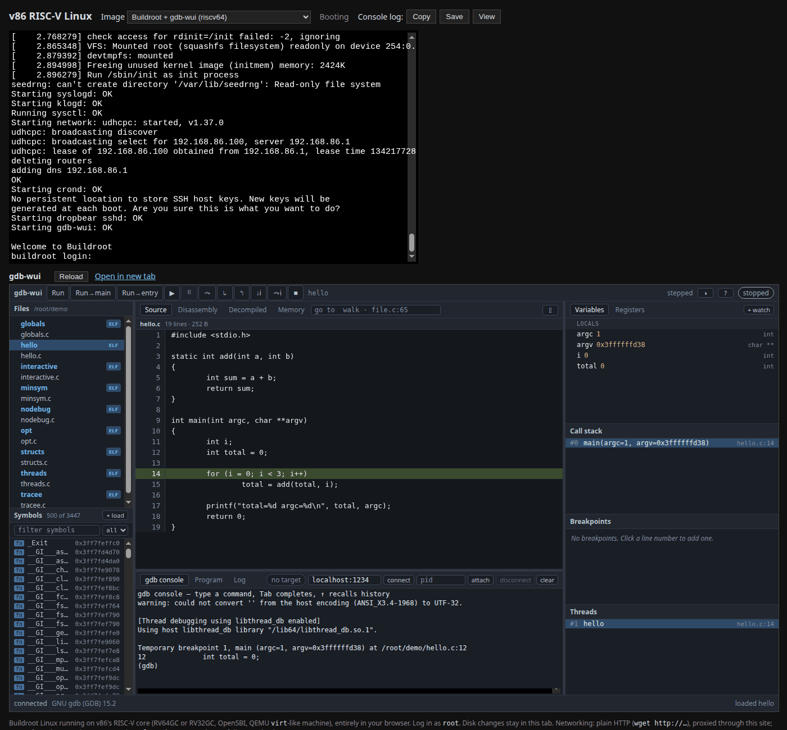

# Try it in your browser

gdb-wui runs live in a browser tab, with nothing to install, on an emulated
Linux machine:

- **[gdb-wui on ARM64](https://v86-arm.turret13.workers.dev/?build=gdb-wui)** —
  an AArch64 machine
- **[gdb-wui on RISC-V](https://v86-riscv.turret13.workers.dev/?build=gdb-wui)** —
  a riscv64 machine

Each page boots Buildroot Linux in an emulator written in WebAssembly (a
[fork of v86](https://github.com/retrocpugeek/v86) that adds ARM64 and RISC-V
machines). gdb 15 and gdb-wui run inside the emulated machine, exactly as they
would on a board on your desk. The gdb-wui window appears next to the machine's
serial console about half a minute after the page loads; until then the panel
says what it is waiting for.

[](images/try-online.png)

## What is there to debug

The project is `/root/demo`: the programs in `testdata/fixtures`, with their
sources, compiled for the emulated machine the way the Makefile's `fixtures`
target compiles them. `hello` is the place to start: click it in the file tree,
click **Run→main**, and step.

The others are the ones the rest of this documentation uses — `globals` for the
[first session](tour.md), `threads`, `structs`, the stripped `nodebug` and the
symbols-only `minsym`. They are built as position-independent executables, so
their addresses differ from the ones shown in the tour.

## Decompiled, with no Ghidra in sight

The **Decompiled** tab works too, for every program there, although Ghidra
could never run on the emulated machine. Each program was decompiled by Ghidra
when the image was built, into a [sidecar](features/decompilation.md#decompiling-without-ghidra-sidecars),
and gdb-wui shows the one whose sha256 matches the program it loads.

That includes **busybox** — the real one, Buildroot's build with its symbols,
a few thousand functions. Click it in the file tree, and in the gdb console
type

```
set args ls -l /
break ls_main
```

then click **Run** and open **Decompiled**: it stops in `ls_main`, ls's own
function, with the program counter marked in Ghidra's C and
`run_applet_no_and_exit` below it on the call stack. The first function takes
a few seconds while gdb-wui indexes the ten-megabyte sidecar; after that each
one is read from it as you go. Press ▶ to let `ls` finish, or step through it.

## Debugging through gdbserver

The image has `gdbserver` too. Log in on the serial console as `root` (no
password) and start it:

```sh
gdbserver :1234 /root/demo/hello &
```

Then click **connect** in the bar above gdb-wui's console, with the address left
at `localhost:1234`. gdb-wui attaches to the remote target, stopped at the
program's first instruction in the dynamic loader, and the program's own output
appears on the serial console.

## How it differs from running it yourself

- **It is slower.** The machine is emulated, so loading a program and the first
  step take a moment longer than on real hardware.
- **The decompilation is fixed.** It was made when the image was built, so
  renaming, retyping and comments, which need a Ghidra to re-decompile, are
  not available.
- **Read-only files.** The root filesystem is read-only and there is no compiler
  in the image, so you can debug the programs in `/root/demo` but not change
  them. Nothing you do leaves your browser tab, and a reload starts afresh.
- **A wide screen helps.** gdb-wui's layout is made for a desktop window. On a
  phone, **Open in new tab** gives it the whole screen.

The page reaches gdb-wui over the emulator's virtual network, which nothing but
that page can reach. That is why gdb-wui runs there with `-listen-anywhere`,
which the [security warning](index.md) asks you not to use on a real network.
